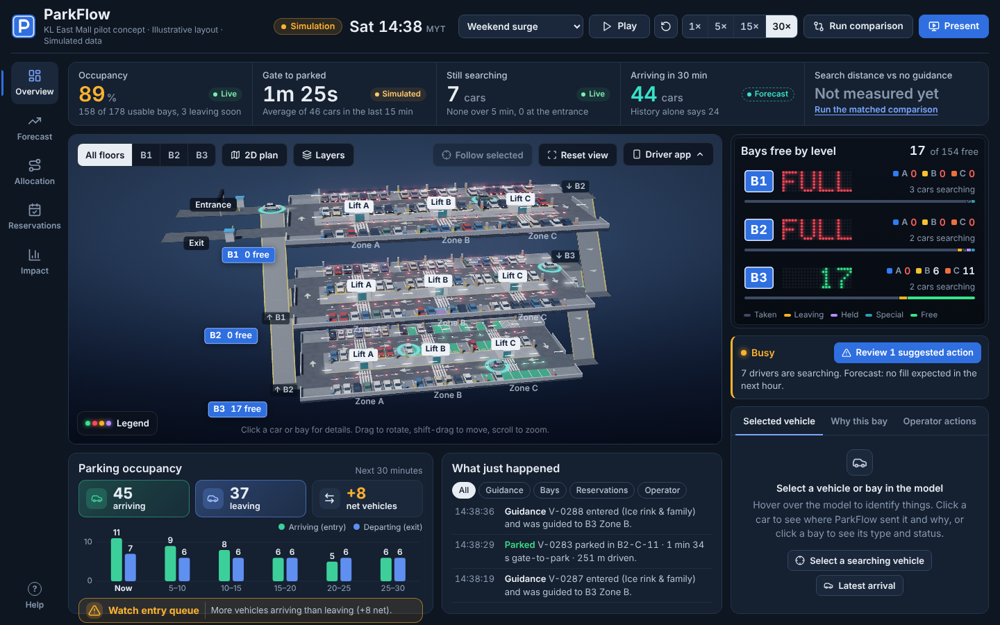
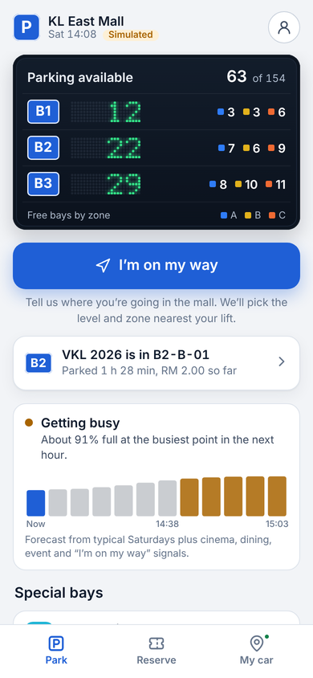
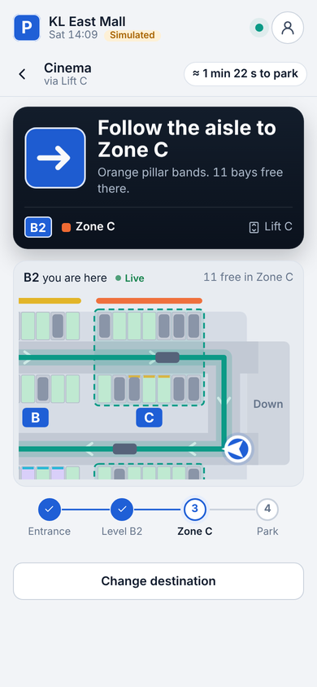
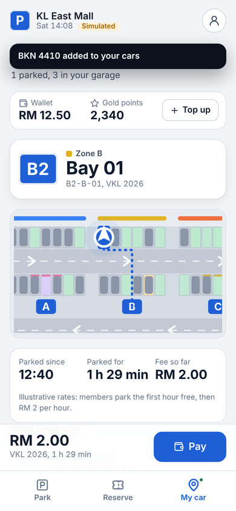
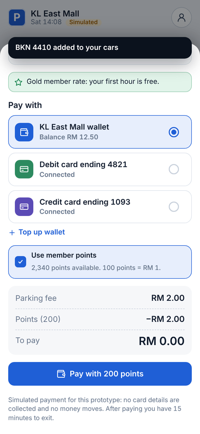

# ParkFlow: reserve capacity, not parking bays

Hackathon prototype for the Sime Darby Property University Hackathon.
KL East Mall pilot concept · illustrative layout · simulated data.

At peak, nobody can count on a parking bay. KL drivers spend about 25 minutes a day hunting for parking, and 26% of
surveyed drivers have given up a trip because of it. Malls reward their best customers with vouchers, not parking, and
reserved VIP bays sit empty or get misused. ParkFlow adds a bookable Priority Zone of about 100 bays by the lifts at KL
East Mall. Big spenders book free with a voucher, care bookings for seniors, OKU and prams are free, and anyone else
can book for RM4. Booked drivers park in any bay in the zone, and every bay not needed for a booking stays open to
everyone. A forecast sets the zone sign green or amber every minute, so the zone holds back only the bays booked drivers
will use. It needs one plate camera and one sign per zone, plus the mall app shoppers already use. Across 1,000
simulated busy Saturdays, every booking got a bay, compared with 86% with no priority system. Bays held back while
walk-ins waited fell to 5 bay-hours a day, against 19 for a VIP section. Level guidance for the rest of the car park
cuts search time by about 69% and saves 1.2 tonnes of CO₂ per busy Saturday. Tested on 30 real car parks, the forecast
is 61% more accurate than "same time last week". Hardware costs about RM43k per mall, and the base case pays back in
2.4 years.



| Driver app: home | Guidance | My cars | Pay |
|---|---|---|---|
|  |  |  |  |

## Live demo

GitHub Pages serves the repository root, which forwards to the site in `docs/`:

- Landing page: https://shenenleow10521.github.io/parkflow/
- Operator command centre: https://shenenleow10521.github.io/parkflow/docs/command.html
- Driver app (open on a phone): https://shenenleow10521.github.io/parkflow/docs/driver.html

Each app links back to the landing page and to the other app. Or open the files in `docs/` straight from a clone.

## Run it

A landing page and two apps on one simulation engine:

- `docs/index.html` is the landing page: the proposal (capacity pooling and the gate rule) with a live simulation of a
  shared zone, an interactive gate calculator and links to both apps. Source: `src/landing/index.html`.
- `docs/command.html` is the operator command centre (3D model, allocation, forecasts with members vs non-members live and since the window opened, impact).
- `docs/driver.html` is the driver app for shoppers: level board, "I'm on my way" guidance with a
  live floor map, Ladies' parking and designated member bookings, parked confirmation, My cars (several cars, where each is parked,
  how long and how much) with find-my-car, and payment by mall wallet, connected card or member points.
- `dist/parkflow.html` and `dist/parkflow-driver.html` are the same pages as body fragments, for hosts that
  add their own HTML skeleton.

Open either in any modern browser. No server, credentials or internet needed
(the Barlow fonts load from Google Fonts when online and fall back to system fonts offline).

## Rebuild

Requires Node 18+ and TypeScript (`npm i -g typescript`).

```
node tools/build.mjs        # tsc -> bundles -> docs/ (standalone site) and dist/ (fragments + local test pages)
python3 tools/functional.py # optional: Playwright acceptance checks for the operator view (25 checks)
python3 tools/driver_flow.py /tmp/drv  # optional: driver app flow test and screenshots (21 checks)
node tools/bundle.mjs /tmp/core.js --core --test tools/core-test.js && node /tmp/core.js   # simulation checks
```

### Demo video

The 4:59 pitch video (Team Hexa, Universiti Malaya) is rendered from code in `tools/video/`, so it can be regenerated after the app changes (Python 3 with Playwright, numpy and scipy; ffmpeg with libx264 and libass).

```
W=/tmp/pf-video
python3 tools/video/capture2.py $W/cap all       # app footage with a virtual clock: driver clips with taps, operator clips, 2x stills, facts2.json
                                                 # (or one part: driver | operator | pressure | entry)
python3 tools/video/render.py $W --video $W/video_raw.mp4   # motion graphics in tools/video/comp.html, 1920x1080 at 30 fps
python3 tools/video/music.py $W/music.wav 299    # original score, synthesised (no samples)
python3 tools/video/subs.py $W                   # captions.ass, parkflow-demo.srt, voiceover-script.md from script.json
python3 tools/video/assemble.py $W               # ParkFlow-demo.mp4 (captions + music) and ParkFlow-demo-for-voiceover.mp4
```

`script.json` holds the chapters and the timed narration; the composition, captions and voiceover script all read from it.

## Code map

| Folder | What it does |
|---|---|
| `src/core/layout.ts` | Three-level schematic car park, one-way lane graph, 180 bays and their types |
| `src/core/scenarios.ts` | Five scenarios, seeded demand generation (arrivals, durations, eligibility, initial occupancy) |
| `src/core/sim.ts` | 1-second discrete-time simulation: movement, parking, departures, reservations, events |
| `src/core/allocation.ts` | Hard constraints + weighted, normalised zone score with plain-language explanation |
| `src/core/forecast.ts` | History-only and history + intent forecasts with editable assumptions |
| `src/core/metrics.ts` | Matched comparison runs (unguided baseline vs ParkFlow) |
| `src/render/gl3d.ts` | WebGL2 renderer: procedural car park and cars, per-floor shadow maps, HDR bloom, bay indicator lights, ceiling lights, camera coverage, guidance route, picking |
| `src/render/scene3d.ts` | Canvas fallback renderer for devices without WebGL2 |
| `src/ui/*` | Level board, KPI strip, inspector, pages, charts, driver app preview, presentation mode |
| `src/mobile/app.ts` | Driver app: screens, guidance wording, booking, pay and leave |
| `src/mobile/map.ts` | Live SVG floor map with a camera that frames the car, its target zone or the walk to the lift |
| `src/mobile/motion.ts` | Motion (motion.dev) adapter with a Web Animations fallback and reduced-motion support |
| `src/styles.css` | Design tokens (top of file) and layout |
| `src/landing/` | Landing page (single file, Motion for animation with a Web Animations fallback) and its screenshots |
| `analysis/` | Python scripts behind every number in the pitch deck: Monte Carlo zone and car park simulations, forecast backtest, business case. See `analysis/README.md` |
| `submission/` | The pitch deck as one self-contained HTML file |

## Design notes

- Dark operations-room theme so the lit 3D model and indicator colours read on a projector.
- Parking-sign blue is the only interface accent. Status colours match the bay lights in the model
  (green free, red taken, blinking amber leaving soon, purple held, blue accessible, pink Ladies' parking) and the
  zone colours match the painted pillar bands (A blue, B yellow, C orange).
- The level board is drawn like the dot-matrix availability sign at a mall entrance; clicking a
  level isolates that floor in the model.
- Barlow (a typeface modelled on road signage) for text, Barlow Semi Condensed for numbers.
- Layers menu in the 3D view: bay lights, guidance route, camera coverage, slow orbit.

## Driver app notes

- Uses the Motion library (`motion@11.11.13` from jsDelivr) for screen pushes, spring sheets, the rolling
  level counts, instruction changes and the route draw-on. Without it (offline), the same animations run on
  the Web Animations API; the about panel on desktop shows which engine is active.
- "I'm on my way" adds the driver's car to the simulation as an intent signal, so it shapes the forecast and
  is guided by the same allocation engine as every other car. "I'm at the entrance" skips the drive there.
- Special bays are Accessible (OKU), Designated member and Ladies' parking. OKU bays are protected and never booked;
  member and Ladies' parking bays can be booked within capacity, always keeping one free for drivers who turn up.
- Membership comes from the account (KL East Mall Rewards, Gold, points), not a tick box: it sets the member
  rate (first hour free), unlocks member bays and verifies member bookings. Ladies' parking is switched on in the
  account ("I'm a woman driver", self-declared; staff may check at the bay).
- My cars starts with one car already parked (since 12:40) so the stay, fee and Pay button are visible at once.
  "Park a new car" picks another car from the garage or adds a new plate.
- Payment: mall wallet (with top-up from a connected card), connected debit or credit card, and member points
  (100 points = RM 1; members earn 10 points per RM 1). All simulated: no card details are collected, no money
  moves, and account data stays in the browser.
- Light and dark themes follow the phone setting.
